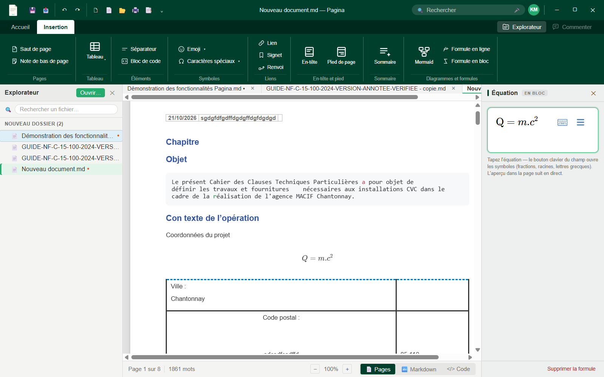

# Pagina — Guide d'utilisation

Guide fonctionnel complet : chaque commande de l'application, commentée. La [référence technique](reference-technique.md) documente l'implémentation pour les développeurs.

## Sommaire

1. [Prise en main](#prise-en-main)
2. [Ruban Accueil](#ruban-accueil)
3. [Ruban Insertion](#ruban-insertion)
4. [Panneaux contextuels](#panneaux-contextuels)
5. [Explorateur de fichiers](#explorateur-de-fichiers)
6. [Mise en page du document](#mise-en-page-du-document)
7. [En-têtes et pieds de page](#en-têtes-et-pieds-de-page)
8. [Impression et export PDF](#impression-et-export-pdf)
9. [Rechercher et remplacer](#rechercher-et-remplacer)
10. [Propriétés du document](#propriétés-du-document)
11. [Paramétrage et utilisateur](#paramétrage-et-utilisateur)
12. [Raccourcis clavier](#raccourcis-clavier)

---

## Prise en main

Pagina ouvre un **dossier de travail** (bouton Explorateur en haut à droite du ruban, ou « Ouvrir »). Tous les fichiers `.md`/`.xmd` du dossier apparaissent dans l'explorateur à gauche ; un double-clic ouvre le document dans un onglet.

Ce que vous voyez est **exactement** ce que vous obtenez : de vraies pages A4 à taille fixe, avec marges, en-tête et pied de page — l'aperçu écran est identique à l'impression et à l'export PDF.

Le fichier enregistré reste un **Markdown standard** : tout ce qui n'existe pas nativement en Markdown (saut de page, sommaire, réglages de mise en page) est encodé dans des commentaires HTML invisibles (`<!-- ... -->`), sans effet de bord dans GitHub, VS Code, Obsidian ou tout autre outil.

### Les règles graduées

Comme dans Word, une règle **horizontale** en haut et une règle **verticale** à gauche des pages (graduation en millimètres, zones de marge grisées). Les **triangles de marge** se tirent à la souris : les marges du document changent **en direct**, avec les mêmes bornes que le dialogue Mise en page.

### La mini-barre de sélection

Sélectionnez du texte : une **mini-barre flottante** apparaît au-dessus de la sélection (G I S, barré, exposant/indice, lien, couleur, surlignage) — comme dans le ruban, les boutons **A** et **S** réappliquent la dernière couleur choisie (le petit chevron ▾ ouvre le nuancier) ; **S** sur du texte déjà surligné retire le surlignage — même esprit que la barre contextuelle de Word. Le clic droit sur du texte ouvre aussi un menu (couper/copier/coller, mise en forme).

---

## Ruban Accueil

### Presse-papiers
- **Coller** : colle le contenu du presse-papiers **avec sa mise en forme** (Word, page web, autre document Pagina : couleurs, tailles, surlignage, listes, tableaux) ; à défaut de mise en forme, le Markdown collé est converti. **Coller en texte brut** (menu clic droit) ne garde que le texte.
- **Couper / Copier** : la sélection est copiée en **HTML mis en forme ET en Markdown** — Word la reçoit avec sa mise en forme, un éditeur de texte reçoit du Markdown.

### Police
- Menus **Police** et **Taille** ; **G** gras, **I** italique, **S** souligné, ~~S~~ barré.
- **x²** exposant, **x₂** indice, `code` en ligne.
- **A** + barre de couleur : couleur du texte ; **S** + barre jaune : surlignage.
- Les deux boutons couleur **mémorisent la dernière couleur choisie** : cliquer sur le bouton seul (sans ouvrir le nuancier) l'applique directement, comme dans Word.
- **Aa** : modifier la casse de la sélection ; Agrandir/Réduire la police ; balai : **effacer la mise en forme**.

### Paragraphe
- Listes à puces, numérotées, de tâches (`[x]`), citation.
- Disposition comme Word, sur deux lignes : listes (puces, numérotée, tâches, citation) puis retraits **Tabulation − / +** ; puis alignements **gauche, centré, droite, justifié** et menu d'interligne.
- **Tabulation − / +** : réduisent/augmentent le retrait du paragraphe courant (pas de 1,25 cm, comme Word).
- **Menu Interligne** : préréglages 1,0 / 1,15 / 1,5 / 2,0 / 2,5 / 3,0 (coche sur la valeur active) ; « Options d'interligne… » ouvre la fenêtre [Paragraphe](#fenêtre-paragraphe--retrait-et-espacement) ; « Ajouter de l'espace avant » (+6 pt) ; « Supprimer l'espace après ».
- Lanceur **⌄** (coin du groupe) : ouvre la fenêtre [Paragraphe](#fenêtre-paragraphe--retrait-et-espacement).

### Styles
- Galerie **Normal / Titre 1 / Titre 2…** : applique un niveau de titre. La numérotation automatique (`1.`, `1.1`, `A.`…) est écrite **dans le texte** — correcte même ouvert ailleurs.
- Le panneau latéral **Styles de titres** (lanceur ⌄) permet de régler police, taille, couleur et schéma de numérotation par niveau.

### Mise en page / Propriétés (grandes icônes en fin de ruban)
- **Mise en page** : ouvre la boîte de dialogue [Mise en page](#mise-en-page-du-document).
- **Propriétés** : ouvre la fenêtre [Propriétés du document](#propriétés-du-document) (titre, sujet, auteur, mots-clés, champs personnalisés).

### Explorateur / Commenter (coin droit)
- **Explorateur** : ouvre/ferme le panneau de fichiers ; le bouton reste surligné tant que le panneau est ouvert.
- **Commenter** : commentaires de relecture (bientôt disponible).

---

## Ruban Insertion

### Pages
- **Saut de page** (Ctrl+Entrée) : force le début d'une nouvelle page.
- **Note de fin de document** (groupe Éléments) : insère la référence `[^n]` et sa définition en fin de document.

### Tableau
- **Tableau** : grille de sélection façon Word (survoler pour choisir lignes × colonnes). Voir [panneau Outils de tableau](#outils-de-tableau).

### Éléments
- **Séparateur** : ligne horizontale.
- **Emoji** : fenêtre à 8 catégories (Smileys, Animaux, Nourriture, Voyages, Activités, Objets, Symboles, Drapeaux).
- **Bloc de code** : paragraphe de code ; la **pastille de langage** apparaît en haut à droite du bloc actif pour choisir la coloration syntaxique.

### Liens
- **Lien** : lien Markdown.
- **Signet** : ancre invisible à la position du curseur ; **Renvoi** : lien qui saute au signet.

### En-tête et pied
- **En-tête** / **Pied de page** : positionne le curseur sur la zone correspondante de la page courante — l'édition se fait **sur la page même**, le ruban entier s'y applique.

### Sommaire / Sections
- **Marqueur** : insère l'emplacement du sommaire ; le panneau **Sommaire** propose ensuite « Mettre à jour » (régénère la liste des titres réels avec liens cliquables) et « Supprimer».
- **Saut de section** (onglet Insertion) : commence une nouvelle partie — la numérotation des titres repart à « 1. » et les sommaires deviennent dédiés : un sommaire placé AVANT la première section liste les sections (table des parties) ; un sommaire placé DANS une section ne liste que les titres de cette section.

### Pages de garde
- **Page de garde** (onglet Insertion) : galerie de 5 modèles (Classique, Moderne, Technique, Minimal, Chantier) avec aperçu, insérés au curseur avec saut de page optionnel.
- Une page de garde est une **page normale du document** : deux repères pointillés discrets (invisible à l'impression) marquent son début et sa fin, et le contenu s'édite **directement sur la page** avec tout l'éditeur — texte, ruban, tableaux…
- Les pages d'une page de garde n'affichent **ni en-tête ni pied de page** (décochable dans le panneau).
- Les **variables de document** (`{{title}}`, `{{author}}`, `{{date}}`…) y sont des champs résolus à l'affichage (le fichier garde la variable) — utilisables aussi partout dans le document.
- Le panneau **Page de garde** s'ouvre dès que le curseur est dans la zone : en-tête/pied on/off, insertion de champs, **« Enregistrer comme type »** pour la retrouver dans la galerie ; les types s'exportent/s'importent en fichiers JSON pour un autre poste.

### Diagrammes et formules
- **Mermaid** : diagramme (la source reste éditable directement dans le bloc).
- **Formule en ligne** / **Formule en bloc** : ouvrent le [panneau Équation](#équation) — **aucun LaTeX à connaître**.

---

## Panneaux contextuels

Une colonne à droite de l'éditeur regroupe les panneaux selon le contexte (onglets quand plusieurs sont actifs). Ils apparaissent seuls, ne recouvrent jamais la page, et se ferment en quittant le contexte ou par ✕.

### Outils de tableau

Apparaît dès que le curseur entre dans un tableau :
- **Lignes** : insérer au-dessus / en dessous / supprimer.
- **Colonnes** : insérer à gauche / à droite / supprimer.
- **Cellules** : fusionner, diviser, vider ; fond de cellule (nuancier).
- **Alignement vertical** : haut / milieu / bas.
- **Bordures** : schéma interactif — **cliquer un côté du schéma applique directement** la bordure (style, épaisseur, couleur réglés au-dessus). Presets : Tout / Extérieur / Intérieur / Aucune.
- Un tableau utilisant des fonctions sans équivalent GFM (fusion, bordures complexes) est enregistré en **HTML valide** dans le `.md` — toujours lisible partout.

### Équation

Les boutons « Formule en ligne / en bloc » insèrent la formule et ouvrent le panneau **Équation** :
- Champ d'équation **WYSIWYG** : tapez l'équation, elle se met en forme en direct (exposants, fractions, racines…) — **aucun LaTeX à connaître**.
- La **palette de symboles** (fractions, racines, lettres grecques, Σ, ∫, opérateurs…) est ouverte par défaut sous le champ ; le bouton ⌨ de l'en-tête la replie.
- L'aperçu dans la page se met à jour à chaque frappe. Cliquer une formule existante rouvre le panneau avec son contenu ; « Supprimer la formule » la retire.
- Le fichier `.md` conserve la syntaxe standard `$formule$` / `$$formule$$`.

### Diagramme (Mermaid)

Ouvert au clic sur un diagramme (ou à l'insertion d'un bloc Mermaid) : la **source du diagramme** s'édite dans le panneau latéral avec un **rendu live** à chaque frappe — plus besoin d'éditer le bloc de code à la main. « Supprimer le diagramme » le retire du document.

- **Modèles métier** : 7 onglets prêts à l'emploi (organigramme de visa, séquence MOA/BE/MOE, planning Gantt, camembert de chiffrage, classes, états, relations) — un clic remplace la source (Ctrl+Z pour revenir).
- **Thème ▾** : couleurs appliquées à tous les diagrammes (Pagina par défaut, plus Clair, Sombre, Forêt, Neutre) — **rendu uniquement**, jamais écrit dans le fichier.
- **Personnaliser…** : trois nuanciers (Principale = fonds, Secondaire = notes/sections, Accent = bordures et liens) qui surchargent le thème choisi.

### En-tête / Pied de page
Ouvert pendant l'édition de la zone : propose les **variables** en un clic — `{{page}}`, `{{pages}}`, `{{date}}`, `{{filename}}`, `{{version}}`, `{{author}}`, `{{title}}`, `{{subject}}`, `{{keywords}}`, `{{created}}`, `{{modified}}` — et **chaque champ personnalisé** créé dans [Propriétés du document](#propriétés-du-document) par son propre nom. Remplacées par leur valeur dans le rendu et à l'impression.

### Sommaire / Styles de titres
Ouverts selon le contexte (curseur dans un sommaire généré / bouton de styles).

---

## Explorateur de fichiers

- **Recherche** : filtre l'arborescence en temps réel (casse et accents ignorés) ; vue aplatie de toutes les correspondances, avec leur chemin. Échap ou champ vidé : retour à l'arbre, l'état déplié préservé.
- **Clic droit** : Nouveau fichier / Nouveau dossier / Renommer / Dupliquer / Supprimer — dialogues intégrés avec validation (caractères interdits refusés), jamais d'invite système.
- **Badge « modifié »** (•) sur tout fichier dont l'onglet a des modifications non enregistrées.
- **Tri** : dossiers puis fichiers, alphabétique insensible à la casse et aux accents.
- **Survol** : chemin complet en info-bulle.
- **Clavier** : flèches pour naviguer, Entrée ouvre/déplie, Suppr supprime (confirmation), F2 renomme, double-clic ouvre.
- Les modifications externes (autres logiciels) sont détectées et l'arbre se rafraîchit automatiquement.

---

## Mise en page du document

Boîte de dialogue à la Word, trois onglets. Réglages enregistrés **dans le document** (commentaire invisible), valables uniquement pour lui.

- **Marges** : Haut/Bas/Gauche/Droite en cm ; Orientation Portrait/Paysage ; aperçu en direct ; « Appliquer à » (tout le document).
- **Papier** : formats A3, A4, A5, Letter, Legal + largeur/hauteur personnalisées ; version et auteur du document (variables `{{version}}`/`{{author}}`).
- **Mise en page** : « Première page différente » (en-tête/pied masqués sur la page 1) ; « À partir du bord » (distance du bord pour l'en-tête et le pied) ; alignement vertical (à venir).
- **Définir par défaut** : les réglages courants deviennent ceux des **nouveaux** documents.

---

## En-têtes et pieds de page

Cliquez sur la zone en haut (ou en bas) de n'importe quelle page : un champ riche s'ouvre sur place. Le contenu est du **Markdown ordinaire** dupliqué sur chaque page :
- Tout le ruban s'y applique (police, taille, couleur, alignement, gras, tableaux…).
- Le panneau latéral insère les **variables** en un clic.
- Échap, ✕ ou un clic dans le document referme le champ ; tout est déjà appliqué.

---

## Impression et export PDF

Imprimé depuis la mise en page affichée (Ctrl+P) — pas de moteur de rendu séparé : l'impression est fidèle à l'écran, en-têtes/pieds et numéros de pages substitués par leurs valeurs réelles. L'export PDF (menu Fichier) produit la même mise en page.

---

## Fenêtre Paragraphe — Retrait et espacement

Comme dans Word (lanceur du groupe Paragraphe, ou « Options d'interligne… » du menu Interligne) :

- **Général** : alignement du paragraphe sous le curseur (gauche / centré / droite / justifié).
- **Retrait** : gauche et droite **en cm** — appliqués au paragraphe courant (même modèle que les boutons Tabulation ±).
- **Espacement** : avant / après **en pt** et interligne — réglages du **document** (comme le ruban et le menu Interligne).
- **Aperçu** en direct : trois mini-paragraphes rendus avec vos réglages.
- **Définir par défaut** : les réglages d'espacement/interligne deviennent ceux des nouveaux documents. **OK** applique et ferme.

---

## Correction automatique

Pendant la frappe (Paramétrage > Édition, activée par défaut, chaque règle se coupe séparément) :

- **Guillemets français** : le guillemet droit `"` devient « ouvrant ou » fermant, avec une espace insécable à l'intérieur (« comme ceci »).
- **Majuscule en début de phrase** : à la première lettre d'un paragraphe, d'un titre ou d'un élément de liste, et après un point, un point d'exclamation ou d'interrogation suivi d'une espace. Pas de majuscule après une abréviation (ex., etc., cf., M., Fig.…), un nombre (« 1.2. ») ni en début de cellule de tableau ; jamais dans un bloc de code ou un texte en code.
- Un Ctrl+Z annule le texte tapé ET sa correction d'un seul coup.

## Correction orthographique

Les mots inconnus du dictionnaire **français** sont soulignés d'un trait rouge ondulé (jamais imprimé ni exporté en PDF).

- **Clic droit** sur un mot souligné : jusqu'à 5 suggestions en gras (un clic remplace le mot en gardant sa mise en forme), **Ignorer** (jusqu'à la fermeture de l'application) ou **Ajouter au dictionnaire** (définitif sur ce poste).
- Le mot en cours de frappe n'est souligné qu'une fois le curseur parti.
- Ne sont **pas** signalés : sigles de 5 lettres et moins en majuscules (CTA, DRV, PPSPS), unités (mm, kW, dBA), références collées à un chiffre (R32, DN50), variables `{{…}}`, adresses web et courriels, blocs de code, formules, diagrammes et sommaires.
- Activer/désactiver : **Paramétrage** (⚙) > Édition > « Correction orthographique (français) ». Activée par défaut.

---

## Rechercher et remplacer

- Le champ **Rechercher** de la barre de titre filtre en direct ; **Ctrl+F** ouvre le panneau latéral **Rechercher** (même requête, champ pleine largeur).
- La liste des **résultats** montre chaque occurrence avec son contexte ; cliquer une occurrence saute à sa position.
- **Remplacer par…** : Remplacer (l'occurrence courante) ou **Tout remplacer**.
- Options : **Respecter la casse**, **Mots entiers**.

---

## Propriétés du document

Bouton **Propriétés** du ruban Accueil (comme Fichier > Informations dans Word) :

- **Titre, Sujet, Auteur, Mots-clés, Commentaires** ; dates de création/modification.
- **Champs personnalisés** libres : chacun devient une variable utilisable dans les en-têtes/pieds par son propre nom (ex. champ `Chantier` → `{{Chantier}}`).
- Tout est enregistré **dans le document** (commentaire de configuration invisible).

---

## Paramétrage et utilisateur

Deux fenêtres **globales** (rien n'est enregistré dans les documents, tout reste sur ce poste) :

- **Paramétrage** (bouton ⚙ de la barre de titre) : afficher/masquer les règles graduées ; auto-sauvegarde du document en cours de modification avec intervalle (30 s à 5 min) ; langue, thème et correction automatique verrouillés « à venir ».
- **Utilisateur** (clic sur l'avatar, coin droit de la barre de titre) : votre prénom et nom — les initiales s'affichent dans l'avatar (« ? » tant que rien n'est renseigné). La connexion au serveur MBEF (Ingenerix) arrivera dans une version ultérieure.

---

## Vérifier et réparer un document

Le bouton **✔ Vérifier** de la barre d'état (devenu **⚠ N problèmes** en sable quand le fichier en contient) ouvre la fenêtre « Vérifier le document ». Elle contrôle le fichier **tel qu'il est sur le disque** :

- zone « page de garde » non refermée (toutes les pages suivantes seraient traitées comme des pages de garde, sans en-tête ni pied de page) ou marqueur de fin orphelin ;
- réglages de mise en page présents en double, illisibles, ou écrits dans un ancien format abîmé ;
- saut de section aux options illisibles.

**Réparer** (ou **Enregistrer et réparer** si le document a des modifications non enregistrées) écrit d'abord une copie de l'ancienne version à côté du fichier (`nom.avant-reparation-AAAAMMJJ-HHMM.md`), corrige, puis recharge le document. Les défauts sans risque (zone de garde non refermée) sont de toute façon corrigés automatiquement à l'ouverture.

## Raccourcis clavier

| Raccourci | Action |
|---|---|
| Ctrl+S | Enregistrer |
| Ctrl+P | Imprimer |
| Ctrl+Z / Ctrl+Y | Annuler / Rétablir |
| Ctrl+B / Ctrl+I / Ctrl+U | Gras / Italique / Souligné |
| Ctrl+Entrée | Saut de page |
| Ctrl+F | Rechercher / Remplacer (panneau latéral) |
| Flèches | Navigation dans l'explorateur / le document |
| Suppr / F2 | Supprimer / renommer (explorateur) |
| Échap | Fermer (recherche, menus, champs, panneaux) |
| Double-clic | Sélectionner un mot |
| Triple-clic | Sélectionner un paragraphe |
| Maj+clic | Étendre la sélection |
