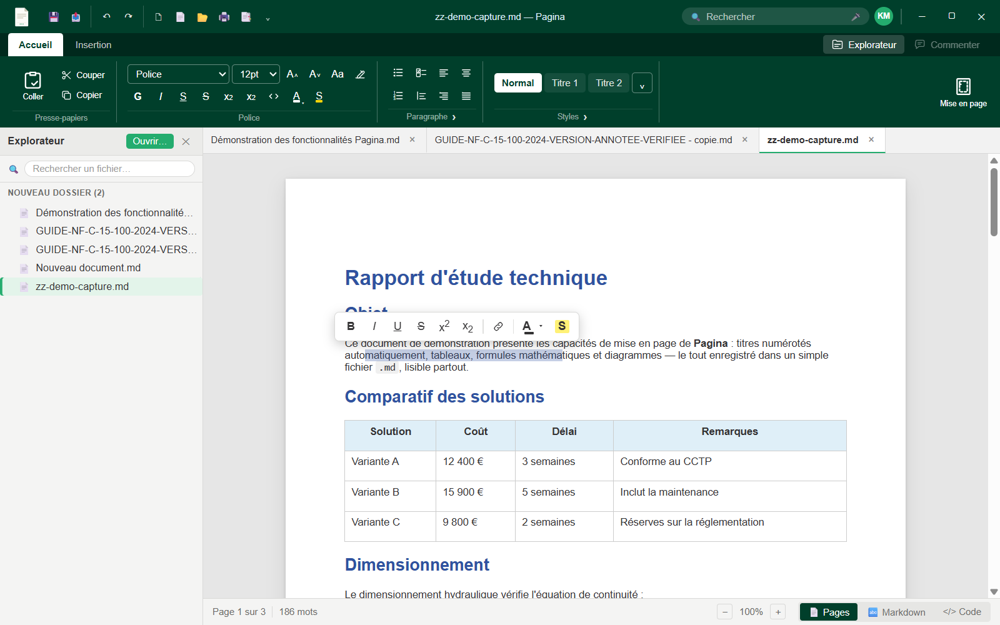
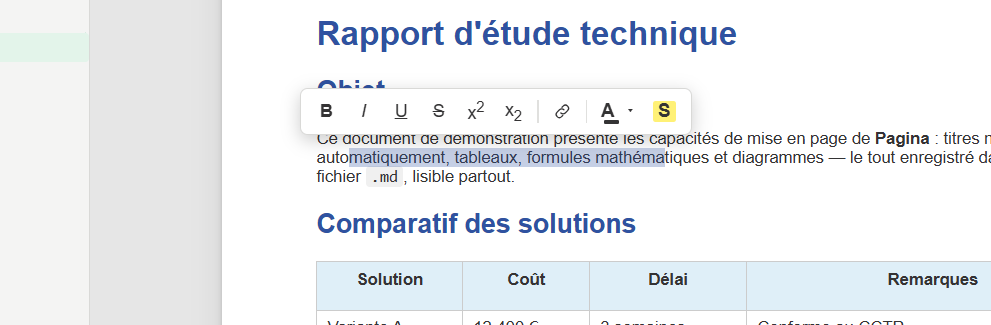
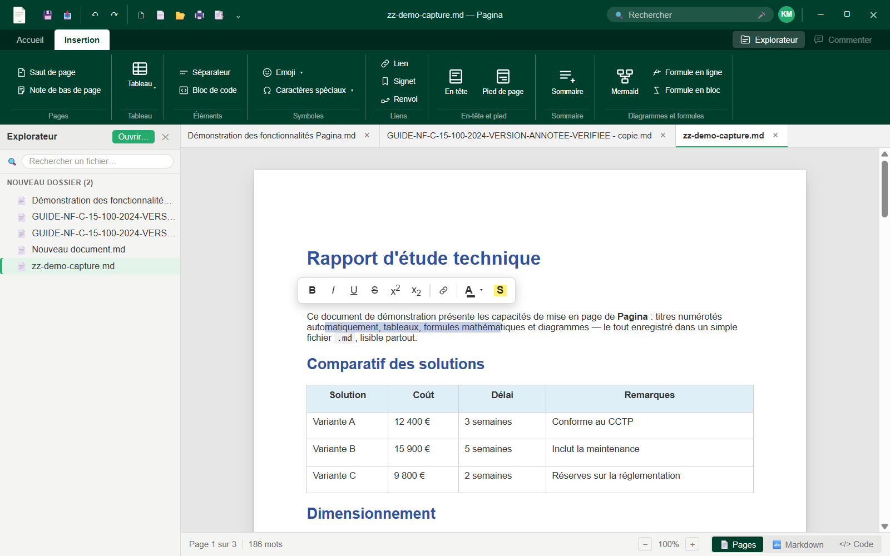
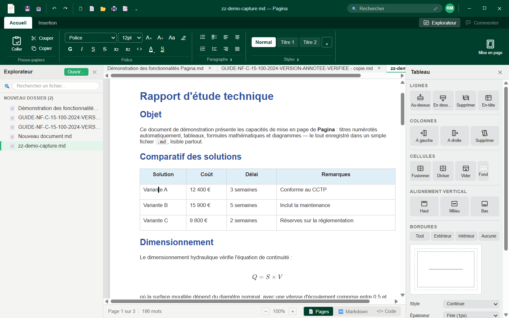

# Pagina — Guide d'utilisation

Guide fonctionnel complet : chaque commande de l'application, commentée. La [référence technique](reference-technique.md) documente l'implémentation pour les développeurs.

## Sommaire

1. [Prise en main](#prise-en-main)
2. [Ruban Accueil](#ruban-accueil)
3. [Ruban Insertion](#ruban-insertion)
4. [Panneaux contextuels](#panneaux-contextuels)
5. [Explorateur de fichiers](#explorateur-de-fichiers)
6. [Mise en page du document](#mise-en-page-du-document)
7. [En-têtes et pieds de page](#en-têtes-et-pieds-de-page)
8. [Impression et export PDF](#impression-et-export-pdf)
9. [Raccourcis clavier](#raccourcis-clavier)

---

## Prise en main

Pagina ouvre un **dossier de travail** (bouton Explorateur en haut à droite du ruban, ou « Ouvrir »). Tous les fichiers `.md`/`.xmd` du dossier apparaissent dans l'explorateur à gauche ; un double-clic ouvre le document dans un onglet.

Ce que vous voyez est **exactement** ce que vous obtenez : de vraies pages A4 à taille fixe, avec marges, en-tête et pied de page — l'aperçu écran est identique à l'impression et à l'export PDF.

Le fichier enregistré reste un **Markdown standard** : tout ce qui n'existe pas nativement en Markdown (saut de page, sommaire, réglages de mise en page) est encodé dans des commentaires HTML invisibles (`<!-- ... -->`), sans effet de bord dans GitHub, VS Code, Obsidian ou tout autre outil.

### La mini-barre de sélection

Sélectionnez du texte : une **mini-barre flottante** apparaît au-dessus de la sélection (G I S, barré, exposant/indice, lien, couleur, surlignage) — même esprit que la barre contextuelle de Word. Le clic droit sur du texte ouvre aussi un menu (couper/copier/coller, mise en forme).

---

## Ruban Accueil

### Presse-papiers
- **Coller** : colle le contenu du presse-papiers ; le Markdown collé est automatiquement converti en mise en forme.
- **Couper / Copier** : la sélection est copiée en **Markdown** (pas en HTML) — collable dans n'importe quel éditeur de texte.

### Police
- Menus **Police** et **Taille** ; **G** gras, **I** italique, **S** souligné, ~~S~~ barré.
- **x²** exposant, **x₂** indice, `code` en ligne.
- **A** + barre de couleur : couleur du texte ; **S** + barre jaune : surlignage.
- **Aa** : modifier la casse de la sélection ; Agrandir/Réduire la police ; balai : **effacer la mise en forme**.

### Paragraphe
- Listes à puces, numérotées, de tâches (`[x]`), citation.
- Alignements **gauche, droite, centré, justifié** (dans cet ordre).
- Lanceur **⌄** (coin du groupe) : ouvre la boîte de dialogue [Mise en page](#mise-en-page-du-document).

### Styles
- Galerie **Normal / Titre 1 / Titre 2…** : applique un niveau de titre. La numérotation automatique (`1.`, `1.1`, `A.`…) est écrite **dans le texte** — correcte même ouvert ailleurs.
- Le panneau latéral **Styles de titres** (lanceur ⌄) permet de régler police, taille, couleur et schéma de numérotation par niveau.

### Mise en page (grande icône en fin de ruban)
Ouvre la boîte de dialogue [Mise en page](#mise-en-page-du-document).

### Explorateur / Commenter (coin droit)
- **Explorateur** : ouvre/ferme le panneau de fichiers ; le bouton reste surligné tant que le panneau est ouvert.
- **Commenter** : commentaires de relecture (bientôt disponible).

---

## Ruban Insertion

### Pages
- **Saut de page** (Ctrl+Entrée) : force le début d'une nouvelle page.
- **Note de bas de page** : insère la référence `[^n]` et sa définition en fin de document.

### Tableau
- **Tableau** : grille de sélection façon Word (survoler pour choisir lignes × colonnes). Voir [panneau Outils de tableau](#outils-de-tableau).

### Éléments
- **Séparateur** : ligne horizontale.
- **Emoji** : fenêtre à 8 catégories (Smileys, Animaux, Nourriture, Voyages, Activités, Objets, Symboles, Drapeaux).
- **Bloc de code** : paragraphe de code ; la **pastille de langage** apparaît en haut à droite du bloc actif pour choisir la coloration syntaxique.

### Liens
- **Lien** : lien Markdown.
- **Signet** : ancre invisible à la position du curseur ; **Renvoi** : lien qui saute au signet.

### En-tête et pied
- **En-tête** / **Pied de page** : positionne le curseur sur la zone correspondante de la page courante — l'édition se fait **sur la page même**, le ruban entier s'y applique.

### Sommaire
- **Marqueur** : insère l'emplacement du sommaire ; le panneau **Sommaire** propose ensuite « Mettre à jour » (régénère la liste des titres réels avec liens cliquables) et « Supprimer ».

### Diagrammes et formules
- **Mermaid** : diagramme (la source reste éditable directement dans le bloc).
- **Formule en ligne** / **Formule en bloc** : ouvrent le [panneau Équation](#équation) — **aucun LaTeX à connaître**.

---

## Panneaux contextuels

Une colonne à droite de l'éditeur regroupe les panneaux selon le contexte (onglets quand plusieurs sont actifs). Ils apparaissent seuls, ne recouvrent jamais la page, et se ferment en quittant le contexte ou par ✕.

### Outils de tableau

Apparaît dès que le curseur entre dans un tableau :
- **Lignes** : insérer au-dessus / en dessous / supprimer.
- **Colonnes** : insérer à gauche / à droite / supprimer.
- **Cellules** : fusionner, diviser, vider ; fond de cellule (nuancier).
- **Alignement vertical** : haut / milieu / bas.
- **Bordures** : schéma interactif — **cliquer un côté du schéma applique directement** la bordure (style, épaisseur, couleur réglés au-dessus). Presets : Tout / Extérieur / Intérieur / Aucune.
- Un tableau utilisant des fonctions sans équivalent GFM (fusion, bordures complexes) est enregistré en **HTML valide** dans le `.md` — toujours lisible partout.

### Équation

Les boutons « Formule en ligne / en bloc » insèrent la formule et ouvrent le panneau **Équation** :
- Champ d'équation **WYSIWYG** : tapez l'équation, elle se met en forme en direct (exposants, fractions, racines…).
- Le **bouton clavier** du champ ouvre le clavier mathématique virtuel : fractions, racines, lettres grecques, Σ, ∫, opérateurs… tout au clic.
- L'aperçu dans la page se met à jour à chaque frappe. Cliquer une formule existante rouvre le panneau avec son contenu ; « Supprimer la formule » la retire.
- Le fichier `.md` conserve la syntaxe standard `$formule$` / `$$formule$$`.

### En-tête / Pied de page
Ouvert pendant l'édition de la zone : propose les **variables** en un clic — `{{page}}`, `{{pages}}`, `{{date}}`, `{{filename}}`, `{{version}}`, `{{author}}` — remplacées par leur valeur dans le rendu et à l'impression.

### Sommaire / Styles de titres
Ouverts selon le contexte (curseur dans un sommaire généré / bouton de styles).

---

## Explorateur de fichiers

- **Recherche** : filtre l'arborescence en temps réel (casse et accents ignorés) ; vue aplatie de toutes les correspondances, avec leur chemin. Échap ou champ vidé : retour à l'arbre, l'état déplié préservé.
- **Clic droit** : Nouveau fichier / Nouveau dossier / Renommer / Dupliquer / Supprimer — dialogues intégrés avec validation (caractères interdits refusés), jamais d'invite système.
- **Badge « modifié »** (•) sur tout fichier dont l'onglet a des modifications non enregistrées.
- **Tri** : dossiers puis fichiers, alphabétique insensible à la casse et aux accents.
- **Survol** : chemin complet en info-bulle.
- **Clavier** : flèches pour naviguer, Entrée ouvre/déplie, Suppr supprime (confirmation), F2 renomme, double-clic ouvre.
- Les modifications externes (autres logiciels) sont détectées et l'arbre se rafraîchit automatiquement.

---

## Mise en page du document

Boîte de dialogue à la Word, trois onglets. Réglages enregistrés **dans le document** (commentaire invisible), valables uniquement pour lui.

- **Marges** : Haut/Bas/Gauche/Droite en cm ; Orientation Portrait/Paysage ; aperçu en direct ; « Appliquer à » (tout le document).
- **Papier** : formats A3, A4, A5, Letter, Legal + largeur/hauteur personnalisées ; version et auteur du document (variables `{{version}}`/`{{author}}`).
- **Mise en page** : « Première page différente » (en-tête/pied masqués sur la page 1) ; « À partir du bord » (distance du bord pour l'en-tête et le pied) ; alignement vertical (à venir).
- **Définir par défaut** : les réglages courants deviennent ceux des **nouveaux** documents.

---

## En-têtes et pieds de page

Cliquez sur la zone en haut (ou en bas) de n'importe quelle page : un champ riche s'ouvre sur place. Le contenu est du **Markdown ordinaire** dupliqué sur chaque page :
- Tout le ruban s'y applique (police, taille, couleur, alignement, gras, tableaux…).
- Le panneau latéral insère les **variables** en un clic.
- Échap, ✕ ou un clic dans le document referme le champ ; tout est déjà appliqué.

---

## Impression et export PDF

Imprimé depuis la mise en page affichée (Ctrl+P) — pas de moteur de rendu séparé : l'impression est fidèle à l'écran, en-têtes/pieds et numéros de pages substitués par leurs valeurs réelles. L'export PDF (menu Fichier) produit la même mise en page.

---

## Raccourcis clavier

| Raccourci | Action |
|---|---|
| Ctrl+S | Enregistrer |
| Ctrl+P | Imprimer |
| Ctrl+Z / Ctrl+Y | Annuler / Rétablir |
| Ctrl+B / Ctrl+I / Ctrl+U | Gras / Italique / Souligné |
| Ctrl+Entrée | Saut de page |
| Ctrl+F | Rechercher (vue Markdown) |
| Flèches | Navigation dans l'explorateur / le document |
| Suppr / F2 | Supprimer / renommer (explorateur) |
| Échap | Fermer (recherche, menus, champs, panneaux) |
| Double-clic | Sélectionner un mot |
| Triple-clic | Sélectionner un paragraphe |
| Maj+clic | Étendre la sélection |
